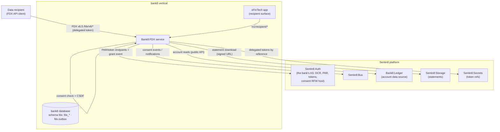

# Bank8:FDX - README

Open-banking data exchange (FDX v6.5): consent-managed account data
sharing between a bank (data provider) and registered third-party data
recipients - plus the money-movement read/cancel surface, event
notifications, and the hosted consent UI.

## Summary

Bank8:FDX is a Rust service that plays the FDX **data provider** role:
it serves consented account/transaction/statement data to registered
recipients over the `/fdx/v6/*` API, enforces consent on every request
with CSDF data minimization, and serves the recipient-side surfaces
(`/v1/recipient/*`) used by eFinTech-style apps and the platform-
hosted consent RFW screens. The provider and the recipient are
independent organizations: the recipient registers its OAuth client
at the provider's authorization server (DCR, RFC 7591), and each
institution keeps its own consent records - the bank its grant
ledger (seeded from the AS's grant event), the fintech its connection
registry.

## Motivation

Open banking requires that every data read is attributable to a live
consent grant with the customer in control: consents are scope-limited,
revocable, and expiring; provider tokens are sender-constrained
(DPoP + secret references); and recipients register dynamically (RFC
7591) rather than being configured by hand. The service centralizes the
consent check, the FDX contract validation, and the audit trail so no
provider route can bypass them.

## Architecture & High-Level Design

## Key Traits and Data Structures

- `middleware` - the provider gate: FDX contract validation
  (`x-fapi-interaction-id`, request shape), per-request consent
  enforcement, and CSDF minimization; every `/fdx/v6/*` route passes
  through it.
- `consent_records` - consent lifecycle: revocation records
  (reason/initiator/timestamp) and introspection-driven expiry fields.
- `event_consumer` - the provider's grant-seed consumer: subscribes to
  the `auth` family and creates grant rows from
  `sentin8:auth:grant:created` events (plus the sys-family env-init
  profile registration).
- `event_notifications` - FDX notification delivery worker: pending
  `notifications` pushed to per-subscription callback URLs,
  HMAC-signed with the per-subscription secret.
- `csdf` - Consent-scoped Data Filter: the minimization layer that
  projects account data to exactly the granted data clusters.

## Rationale, Trade-offs, and Alternatives

- **Consent check in middleware, not per-handler** - the provider
  surface cannot grow a route that forgets the check; the RLS +
  middleware combination is the two-layer enforcement.
- **Provider tokens as secret references** - the delegated tokens the
  recipient holds are never plaintext columns; only
  `sentin8-secrets://` references plus expiry metadata are stored.
- **DPoP sender-constraining for delegated tokens** - the recipient's
  per-provider ES256 key mints RFC 9449 proofs for each token
  exchange at the provider's AS, mirroring the BFF FAPI pattern.
- **Two ledgers, one ceremony** - the bank's grant ledger and the
  fintech's connection registry are separate tables in separate
  environments kept in step by the same OAuth ceremony (the AS grant
  event + the shared handle in the OAuth `state`) - instead of one
  shared row both sides read across a tenant boundary, which would
  couple the institutions to one platform.
- **Hosted consent RFW** - the consent screens are Remote Flutter
  Widget definitions served to auth-ui's consent host, so the customer
  sees the bank's consent UI inside the platform's OAuth flow instead of
  a recipient-embedded page.

## Internal Implementation & Invariants

- Every provider data call requires a valid, unexpired, unrevoked
  consent whose scopes cover the requested cluster - enforced twice
  (middleware + RLS).
- Data clusters outside the consent are stripped by the CSDF filter
  before serialization.
- Out-of-scope FDX families return the FDX-standard unsupported-operation
  response - never a silent stub.
- All domain tables FORCE-RLS on `env_id`; provider profiles are
  env-scoped with secret-reference-only columns.
- No SQL spans the provider and recipient environments - each side's
  instance reads and writes only its own tenant's tables.

## Unresolved Questions / Future Designs

- Recipient DPoP key sealing is **done**: secrets-reference column +
  call-time resolution (DESIGN.md §10).
- Certification metrics are **implemented** from `audit_events` +
  consent transitions behind a bounded cache; the daily rollup + evidence
  page are deferred at scale (DESIGN.md §10).
- Response caching for recipient polling: deferred with an explicit
  trigger (recipient exceeding FDX poll guidance + degraded p95); design
  sketched in DESIGN.md §10.

---

**Design attribution:** bank8:fdx and its underlying concepts were designed by Hamid Jahanzad <Hamid@Jahanzad.com>.
